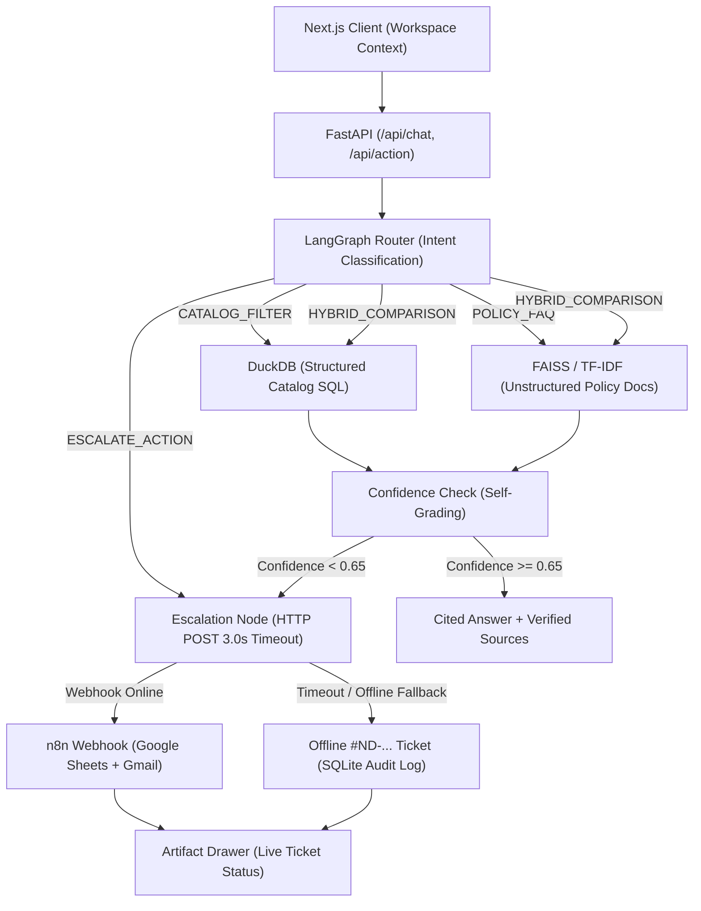

# NexusDesk AI

Multi-tenant customer support and product catalog assistant built with Next.js, FastAPI, LangGraph, FAISS, DuckDB, and n8n.

- **Live Application:** [https://nexusdesk-ai-flf7.vercel.app/](https://nexusdesk-ai-flf7.vercel.app/)
- **API Service:** [https://nexusdesk-ai.vercel.app/](https://nexusdesk-ai.vercel.app/)

---

## Architecture

The system executes a cyclic agentic workflow across specialized data stores. User inquiries are routed to either structured catalog queries, unstructured semantic document retrieval, or automated escalation pipelines based on confidence grading.



### Architectural Principles

- **Workspace Isolation:** Every vector chunk, DuckDB SQL catalog table, session turn, and escalation ticket is partitioned by `workspace_id` (`retail_ops`, `clinic_ops`, `hr_ops`, or custom client IDs). Custom workspaces without a catalog bypass SQL execution and query policy vector partitions directly.
- **Retrieval & Synthesis Fallback:** When external LLM provider keys (`GEMINI_API_KEY`, `OPENAI_API_KEY`) are not configured or hit upstream quotas, a deterministic synthesis engine extracts matching source sentences, trims them at strict sentence boundaries (`.`, `!`, `?`), and formats a concise 2–3 bullet answer without mid-word truncation or unrelated section dumping.
- **Offline Ticket Resilience:** All HTTP POST requests to `N8N_WEBHOOK_URL` enforce a strict 3.0-second timeout. If the webhook tunnel is offline or unreachable, the system catches the error cleanly, marks the ticket `#ND-XXXXXX` as `queued_offline`, records the full payload to SQLite, and returns a successful response so the client interface never blocks.

---

## What It Does

### 1. Isolated Workspaces
- **E-Commerce & Retail (`retail_ops`):** Seeded with a 30-day return policy, 1-year limited hardware warranty rules, and an Amazon consumer electronics catalog.
- **Clinic & Patient Support (`clinic_ops`):** Seeded with outpatient consultation rates, specialist fees, health insurance copays (BCBS, Aetna, Cigna, UnitedHealthcare), 24-hour cancellation policies, and surgical aftercare protocols.
- **HR & Employee Operations (`hr_ops`):** Seeded with annual PTO accrual schedules, flexible hybrid work hours, domestic meal per diem rules ($75/day), $25 itemized receipt thresholds, and 36-month IT hardware refresh cycles.
- **Custom Ingestion Engine:** Accepts public website URLs (HTML parser with script/navbar stripping, 5MB payload limit, and private IP/SSRF protection), document uploads (`.pdf`, `.csv`, `.md`, `.txt`), or raw text to create isolated tenant workspaces dynamically.

### 2. Grounded Answers & Citations
- Classifies user intent across four operational paths: `CATALOG_FILTER`, `POLICY_FAQ`, `HYBRID_COMPARISON`, and `ESCALATE_ACTION`.
- Executes SQL queries in DuckDB for numerical constraints (price thresholds, discounts, star ratings) to eliminate hallucinations on structured data.
- Executes vector similarity searches over unstructured policy guidelines.
- Attaches clickable citation chips with semantic relevance scores and structured product specification cards to assistant responses.

### 3. Human Handoff Pipeline
- Re-evaluates retrieval confidence on a 0.0 to 1.0 scale. If confidence falls below 0.65, triggers an automatic query reformulation loop before escalating.
- Generates structured, searchable ticket identifiers (`#ND-` followed by 6 alphanumeric characters).
- Includes an interactive inline Action Card below operational answers (expense claims, appointment bookings, return exceptions) that allows users to trigger workflows directly.
- Dispatches structured payloads to n8n workflows (`Webhook -> Google Sheets -> Gmail`) with offline fallback support.

### 4. Product Interface
- Dual theme support: Dark Mode (`#0F172A` canvas, `#131C2E` surface, `#1B263B` cards, `#38BDF8` sky-cyan accents) and Light Mode (`#F8FAFC` canvas, `#FFFFFF` cards, `#CBD5E1` borders, slate-900 typography).
- Workspace switcher with category pills and live verified source counters.
- Collapsible sidebar displaying session history labeled by the first 36 characters of the user's initial inquiry.
- Workspace authentication modal with Google account chooser profiles (`Workspace Owner`, `Support Lead`) and direct work email input.
- Slide-over Artifact drawer displaying verified citation text, catalog specs, and live ticket audit logs.
- Dedicated B2B compliance pages: `/privacy` (EU GDPR Articles 15–22, zero model training), `/terms` (commercial SLA, IP ownership), Pricing modal, and Cookie preferences modal.

---

## Repository Structure & Local Setup

### Directory Tree

```text
nexusdesk-ai/
├── backend/
│   ├── database.py         # SQLite persistence for tickets, session history, and sources
│   ├── main.py             # FastAPI REST endpoints, Pydantic schemas, and CORS handling
│   ├── nexusdesk.db        # SQLite database file
│   └── rag_pipeline.py     # LangGraph workflow, FAISS/TF-IDF store, and DuckDB engine
├── data/
│   ├── amazon_products.csv # Retail catalog dataset for SQL queries
│   ├── clinic_policies.md  # Healthcare consultation pricing and clinical guidelines
│   ├── hr_policies.md      # Employee operations handbook and expense rules
│   └── policies.md         # Store return, warranty, and replacement policies
├── frontend/
│   ├── package.json        # Next.js 14 and Tailwind CSS dependencies
│   ├── tailwind.config.ts  # Palette and theme definitions
│   └── src/
│       ├── app/            # App router pages (/, /privacy, /terms, globals.css)
│       ├── components/     # UI components (Header, Sidebar, ChatCanvas, Composer, ArtifactDrawer)
│       ├── lib/            # Constants and pre-configured workspace metadata
│       └── types/          # TypeScript interfaces for API contracts and session states
├── .env.example            # Environment variable template
├── index.py                # Serverless entrypoint for Vercel Python runtime
├── requirements.txt        # Production dependencies (pure-Python, zero heavy binary wheels)
└── vercel.json             # Vercel deployment build and include configurations
```

### Local Setup

#### Prerequisites
- Python 3.11 or 3.12
- Node.js 18+ and npm

#### 1. Backend Service
```bash
# Clone the repository
git clone https://github.com/ndia4343/nexusdesk-ai.git
cd nexusdesk-ai

# Create and activate virtual environment
python -m venv .venv

# Windows:
.\.venv\Scripts\activate

# macOS / Linux:
source .venv/bin/activate

# Install dependencies
pip install -r requirements.txt

# Start FastAPI development server
python -m uvicorn backend.main:app --host 0.0.0.0 --port 7860 --reload
```

The API service boots at `http://localhost:7860` with interactive Swagger docs at `http://localhost:7860/docs`.

#### 2. Frontend Application
```bash
# From the project root, navigate to the frontend directory
cd frontend

# Install dependencies
npm install

# Start Next.js development server
npm run dev
```

The web application runs at `http://localhost:3000`.

---

## Environment Variables

Configure these variables in a `.env` file in the root directory. Values shown below are safe development defaults:

| Variable | Description | Safe Default / Example |
| :--- | :--- | :--- |
| `PORT` | Local backend server listening port | `7860` |
| `DATABASE_PATH` | SQLite database file location | `backend/nexusdesk.db` |
| `N8N_WEBHOOK_URL` | Optional n8n escalation webhook endpoint | `https://your-n8n-instance.com/webhook/nexusdesk-escalation` |
| `GEMINI_API_KEY` | Optional Google Gemini key for synthesis | `AIzaSy...` |
| `OPENAI_API_KEY` | Optional OpenAI key for synthesis | `sk-proj-...` |
| `NEXT_PUBLIC_API_URL` | Frontend client target URL for the backend | `http://localhost:7860` |

If no API keys are provided, the backend automatically operates in deterministic grounded mode using in-memory vector search and DuckDB SQL.
